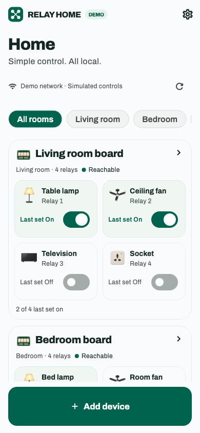
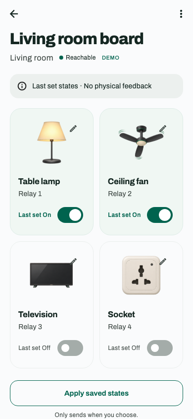
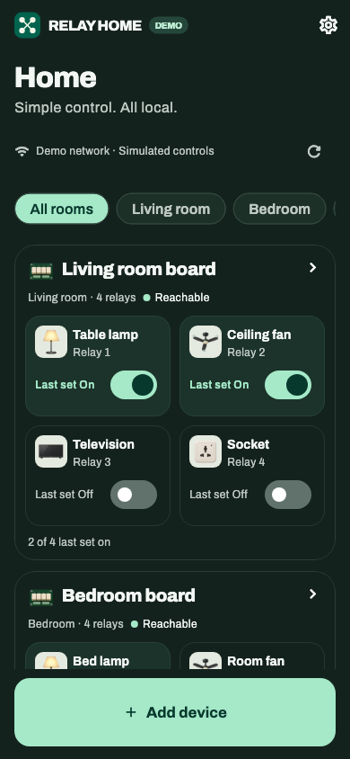

# Relay Home

A Flutter Android app for pairing and controlling ESP8266 ESP-01 boards with four relays over your local Wi-Fi. Emerald controls, light and dark themes, room filters, and paired appliance illustrations keep each board and relay easy to recognize.

<p>
  
  
  
</p>

## Install and use

Build an APK with `flutter pub get` followed by `flutter build apk --release`. The output is `build/app/outputs/flutter-apk/app-release.apk`; generated APKs are excluded from this source repository. The current Gradle configuration uses a local Android debug key for development builds, including release mode. Configure a private release keystore before publishing through a store.

1. Install the APK on an Android phone (Android 7.0/API 24 or later).
2. Connect the phone to the same Wi-Fi network the board should use. Provisioning needs 2.4 GHz Wi-Fi.
3. Tap **Add device**, manually put the board in SmartConfig pairing mode, then tap **Board is ready**.
4. Review the detected network name or enter it manually and enter its password. Passwords are not saved.
5. Select the responding board, give it a name and room, and customize each relay.
6. Tap a switch on Home or open a board for larger controls. The app uses channels 1–4.

For a board already on Wi-Fi, choose **Find an existing device**, or enter its local IP manually. Port discovery identifies possible matches, not a guaranteed board identity. Check its address against the router/device before saving. **Find device again** and **Update IP address** preserve names and relay history when DHCP changes an address.

First launch is an empty real home. **Settings → Demo home** opens sample devices and simulated switches stored separately. Switching demo mode never replaces real saved devices. Demo setup and discovery are also simulated and labeled.

## What the states mean

This board's documented stock protocol has no relay-state query or physical acknowledgement. **Last set On/Off** is the last command the app sent; it does not prove the contacts moved. A channel with no command history is **Unknown**. A connection that fails after sending is **Uncertain**.

Reopening the app restores names, artwork, rooms, and last-set states, then checks reachability. It never replays commands automatically. **Apply saved states** explicitly sends the known saved values when requested. Hardware restart, other controllers, and wiring to NC instead of NO can make an appliance's actual state differ from the saved command.

## Pairing and Android access

- Uses `esp_smartconfig` 3.0.0 with **classic ESPTouch V1**, matching this board's stock firmware.
- The phone sends network credentials to a board already listening for SmartConfig. There is no Bluetooth scan or guaranteed pre-provisioning device list.
- Setup is bounded to 90 seconds, can be cancelled, and collects responses before checking their control ports.
- Nearby Wi-Fi/location permissions are requested when detecting Wi-Fi for setup/discovery. Android may also need Location services enabled to reveal SSID/BSSID. Manual SSID entry remains available.
- A native Kotlin bridge reads Wi-Fi IPv4/mask/SSID/BSSID/frequency, acquires a multicast lock, and temporarily binds provisioning to Wi-Fi. Setup completion, cancellation, backgrounding, and activity teardown release resources.
- The package runs in an owned isolate per attempt because version 3.0.0 retains an internal receive port after `stop()`. Cleanup stops its worker and exits the owned isolate, allowing another attempt.
- There is no account, backend, analytics, cloud relay, or credential storage.

Client isolation, a 5 GHz-only network, VPN routing, or a board that is not in pairing mode can prevent setup or local access. Internet connectivity is not required. Keep the phone connected to the intended Wi-Fi when provisioning or controlling.

## How it works

`lib/screens` renders the flow and listens to `AppController`. The controller owns device metadata, command state, connection checks, cancellation, and persistence. Native network-change events and app resume refresh connectivity without sending relay commands.

`TcpRelayTransport` opens TCP port **8080**, waits **500 ms**, sends exactly four binary bytes, keeps the connection open for **2 seconds**, then closes it. These timings were confirmed using a Python client with the board used during development:

```
[0xA0, channel, state, (0xA0 + channel + state) & 0xFF]
channel: 1–4
state:   1 = ON, 0 = OFF
relay 1 ON: A0 01 01 A2
```

Commands cannot overlap on a board. A failure never causes an automatic retry. Reachability probes open and close TCP with no payload. Discovery uses the actual Wi-Fi subnet, bounded concurrency, cancellation, and a maximum of 4094 hosts. Wider networks use manual IP entry. No device is silently rebound merely because an address has an open port.

Local storage uses separate JSON records for real and demo devices, plus theme/demo preferences. Stable local IDs and available provisioning MACs identify records; IP addresses are mutable. Saved objects include four channels, display names, artwork keys/file references, last command values, uncertainty, and timestamps. Reachability is rechecked rather than persisted as live truth. Custom images are copied from Android's photo picker into the app's private documents directory.

## Artwork

`assets/art` contains 16 original generated transparent PNGs: 14 appliance presets, a board, and a router. Each PNG has an ON frame on the left and an OFF frame on the right. `ApplianceArt` caches bounded decoded sprites and selects a frame at paint time; no image request is made at runtime. Imported photos have a bundled-art fallback if a file becomes unavailable.

Presets: switch, computer, laptop, TV, bulb, table lamp, wall light, ceiling light, pendant light, ceiling fan, standing fan, air conditioner, socket, water pump. Board-style presets share the board illustration. The app mark is a native vector and matching Flutter painter. Archivo is bundled with its OFL license. Generation prompts and provenance are in `assets/ARTWORK.md`.

## Verification

Static analysis is clean, all 24 automated tests pass, and the release APK builds and passes signature verification. See `docs/VALIDATION.md` for evidence and limits. Emulator runtime testing was blocked by available disk space; physical pairing and switching still need the Android phone and board.

## Develop

Use Flutter with Dart 3.10 or later, an Android SDK with API 36, and the Java version required by the Android Gradle plugin. Run `flutter doctor` to check the local toolchain.

```sh
flutter pub get
flutter analyze
flutter test
flutter run
flutter build apk --release
```

Optional rendered UI captures:

```sh
flutter test test/workflow_test.dart --dart-define=CAPTURE_SCREENS=true --update-goldens
```

They are written to `docs/screenshots/`. Normal tests do not compare machine-dependent raster goldens.

Tests cover exact command frames and real loopback TCP delivery, no-payload probes, subnet bounds, persistent last states without replay, demo isolation, command locking, cancellation races, changed target addresses, responsive controls, and the full setup/personalization flow with injected service doubles. Passing these does not establish physical-board compatibility on every Android phone. SmartConfig radio delivery and relay clicks require a phone and the actual board.

## Project layout

- `lib/main.dart`, `lib/theme.dart`: startup, lifecycle, themes.
- `lib/models.dart`, `lib/app_controller.dart`: device/channel records and state orchestration.
- `lib/services/`: network bridge, ESPTouch, TCP commands, storage/image imports.
- `lib/screens/`: home, setup, controls, customization, settings.
- `lib/widgets/`: shared mark, information panel, relay tiles, cached artwork.
- `android/app/src/main/kotlin/.../MainActivity.kt`: Android Wi-Fi integration.
- `test/`: protocol, controller, UI, and workflow checks.
- `assets/`: bundled artwork and font.
